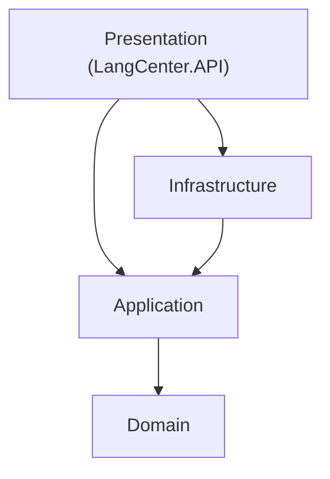
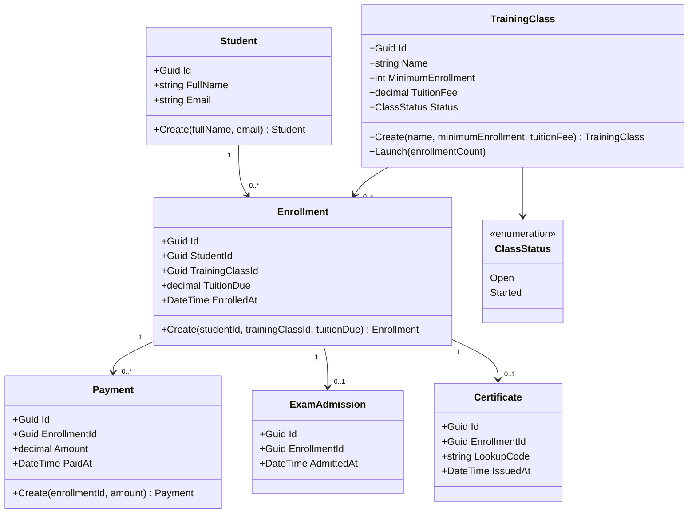
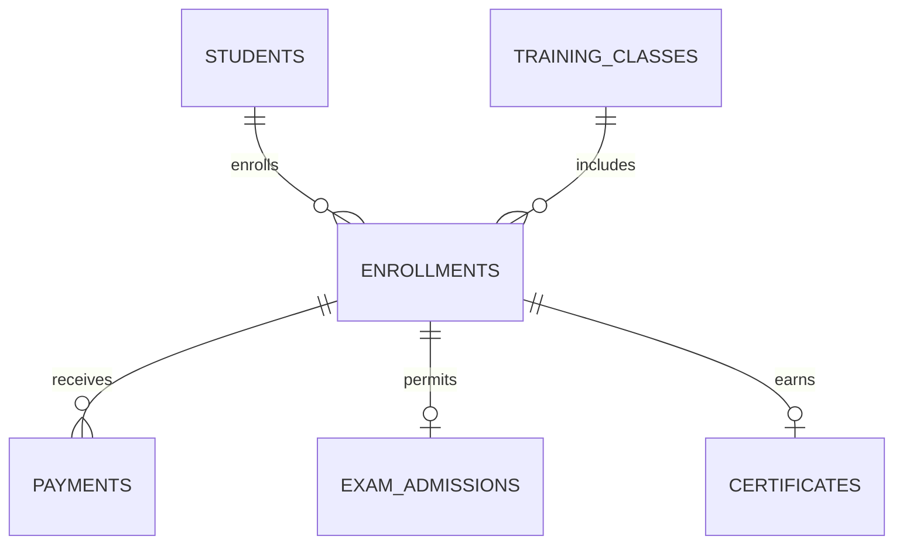

# Thiết kế LangCenter

## Kiến trúc bốn tầng

| Tầng | Project | Trách nhiệm |
| --- | --- | --- |
| Domain | `LangCenter.Domain` | Thực thể, trạng thái, hành vi nghiệp vụ và hợp đồng repository sát Domain |
| Application | `LangCenter.Application` | Command, query, handler, DTO và điều phối quy tắc cần đọc hoặc ghi dữ liệu |
| Infrastructure | `LangCenter.Infrastructure` | EF Core, PostgreSQL, hiện thực repository và dịch vụ kỹ thuật |
| Presentation | `LangCenter.API` | Controllers, yêu cầu HTTP, phân quyền, Swagger, cấu hình DI và phản hồi lỗi |

`LangCenter.Tests` kiểm thử các tầng và gọi API qua host kiểm thử. Các mũi tên dưới đây biểu diễn chiều tham chiếu project.

## Mô hình lớp Domain

`TrainingClass.Launch(enrollmentCount)` kiểm tra trạng thái và ngưỡng sĩ số. Handler của Application lấy số ghi danh từ repository và điều phối việc lưu trạng thái. Tương tự, handler dự thi lấy tổng học phí đã thu trước khi áp dụng QT05.

## Quy ước từ sáu solution tham khảo

| Bài mẫu | Quy ước dùng cho LangCenter |
| --- | --- |
| C1 | Entity có thuộc tính `private set`, factory method `Create(...)` và phương thức thay đổi trạng thái rõ nghĩa. |
| C2 | Tiêm phụ thuộc qua constructor. Đặt tên test theo `Behavior_Condition_ExpectedResult`, ví dụ `Launch_BelowMinimumEnrollment_RejectsLaunch`. |
| C3 | Tổ chức Application theo tính năng. Đặt tên dạng `CreateClassCommand`, `CreateClassCommandHandler` và `HandleAsync`. Controller nhận request, gọi handler và trả kết quả HTTP. |
| C4 | Đặt ánh xạ EF Core trong Infrastructure, ràng buộc tính duy nhất ở cơ sở dữ liệu và chuyển lỗi tập trung thành `ProblemDetails`. |
| C5 | Tổ chức đăng nhập JWT và policy phân quyền theo vai trò trong API. |
| C6 | Dùng .NET 10, một project test xUnit, `WebApplicationFactory` cho API, Docker Compose và CI. |

Các tên lớp, phương thức, biến và ca kiểm thử viết bằng tiếng Anh. Các thao tác bất đồng bộ có hậu tố `Async` và chuyển tiếp `CancellationToken` tới tầng truy cập dữ liệu. Domain giữ quy tắc của từng thực thể. Application giữ quy tắc phối hợp giữa các thực thể. Repository và constructor injection giúp kiểm thử handler bằng phụ thuộc thay thế.

Bài C2 dùng Strategy cho nhiều định dạng báo cáo và Factory để chọn kênh thông báo. Phạm vi hiện tại có một cách tính công nợ và một luồng cấp chứng chỉ. Nhóm bổ sung mẫu thiết kế khi có các biến thể cần biểu diễn.

## Cơ sở dữ liệu PostgreSQL

| Bảng | Cột nghiệp vụ chính | Ràng buộc |
| --- | --- | --- |
| `students` | `Id`, `FullName`, `Email` | Khóa chính `Id` |
| `training_classes` | `Id`, `Name`, `MinimumEnrollment`, `TuitionFee`, `Status`, `StartedAt` | Sĩ số tối thiểu dương, học phí không âm |
| `enrollments` | `Id`, `StudentId`, `TrainingClassId`, `TuitionDue`, `EnrolledAt` | Khóa ngoại đến học viên và lớp, duy nhất theo cặp `StudentId` và `TrainingClassId` |
| `payments` | `Id`, `EnrollmentId`, `Amount`, `PaidAt` | Khóa ngoại đến ghi danh, số tiền dương |
| `exam_admissions` | `Id`, `EnrollmentId`, `AdmittedAt` | Tối đa một bản ghi cho mỗi lượt ghi danh |
| `certificates` | `Id`, `EnrollmentId`, `LookupCode`, `IssuedAt` | Duy nhất theo `EnrollmentId` và theo `LookupCode` |

Dùng `uuid` cho các ID, `numeric(14,0)` cho tiền và UTC cho thời điểm phát sinh. Dùng migration để tạo và sửa lược đồ khi bổ sung entity. Identity quản lý bảng tài khoản và vai trò. Mã tra cứu chứng chỉ là giá trị ngẫu nhiên độc lập với ID và dữ liệu học viên.

Ứng dụng phải giữ việc kiểm tra và ghi trong cùng phạm vi giao dịch khi có yêu cầu đồng thời. Ghi danh và khai giảng cần phối hợp theo lớp. Ghi nhận thanh toán và xác nhận dự thi cần phối hợp theo lượt ghi danh.

## Hợp đồng API dự kiến

| Phương thức | Đường dẫn | Quyền | Thành công |
| --- | --- | --- | --- |
| GET | `/healthz` | Công khai | `200` khi tiến trình API sẵn sàng trả lời |
| POST | `/api/auth/login` | Công khai | `200` với access token |
| GET | `/api/auth/me` | Đã đăng nhập | `200` với ID, email và danh sách vai trò |
| GET, POST | `/api/students` | Admin, Registrar | `200` danh sách hoặc `201` học viên mới |
| GET | `/api/students/{id}` | Admin, Registrar | `200` chi tiết học viên |
| GET, POST | `/api/classes` | Admin, Registrar | `200` danh sách hoặc `201` lớp mới |
| POST | `/api/classes/{classId}/enrollments` | Admin, Registrar | `201` lượt ghi danh mới |
| POST | `/api/classes/{id}/launch` | Admin, Registrar | `200` lớp đã khai giảng |
| POST | `/api/enrollments/{id}/payments` | Admin, Cashier | `201` khoản thanh toán mới |
| GET | `/api/enrollments/{id}/balance` | Admin, Registrar, Cashier | `200` với số phải thu, đã thu và còn nợ |
| POST | `/api/enrollments/{id}/exam-admission` | Admin, Registrar | `201` xác nhận đủ điều kiện dự thi |
| POST | `/api/enrollments/{id}/certificate` | Admin, Registrar | `201` chứng chỉ, mã và URL tra cứu |
| GET | `/api/certificates/{id}/qr` | Admin, Registrar | `200` ảnh QR |
| GET | `/api/certificates/verify/{lookupCode}` | Công khai | `200` kết quả tra cứu |
| GET | `/api/reports/classes/{id}/tuition` | Admin, Cashier | `200` báo cáo công nợ theo lớp nếu nhóm chọn chức năng này |

Các request và response JSON dùng `camelCase`. Request đăng nhập gồm `email` và `password`. Tạo học viên nhận `fullName` và `email`. Request tạo lớp gồm `name`, `minimumEnrollment` và `tuitionFee`. Ghi danh nhận `studentId`. Ghi nhận thanh toán nhận `amount`. Cấp chứng chỉ nhận `completionConfirmed`. URL trên QR sử dụng địa chỉ API cấu hình cho môi trường demo để điện thoại truy cập được.

### Lỗi HTTP

| HTTP | Trường hợp |
| --- | --- |
| `400` | Dữ liệu đầu vào sai hoặc vi phạm quy tắc như thiếu sĩ số hay còn nợ học phí |
| `401` | Thiếu thông tin xác thực hợp lệ hoặc đăng nhập sai |
| `403` | Tài khoản đã xác thực thiếu quyền |
| `404` | Không tìm thấy tài nguyên hoặc mã tra cứu |
| `409` | Ghi danh trùng hoặc yêu cầu tạo bản ghi đã tồn tại |
| `429` | Vượt giới hạn đăng nhập theo địa chỉ IP |
| `500` | Lỗi hệ thống |

Phân tầng lỗi theo C4. Application báo lỗi nghiệp vụ theo loại. Presentation chuyển sang `ProblemDetails` với `status`, `title`, `detail`, `instance` và `traceId`. Với lỗi hệ thống, response công khai dùng thông báo chung. Log ở máy chủ giữ chi tiết phục vụ chẩn đoán.

## Kiểm thử và môi trường

- Kiểm thử đơn vị các biên về sĩ số, giá trị thanh toán và điều kiện dự thi.
- Kiểm thử tích hợp đăng nhập, role, ghi danh, lỗi nghiệp vụ và tra cứu chứng chỉ. Các ca kiểm thử ràng buộc dữ liệu cần cơ sở dữ liệu quan hệ kiểm thử.
- Docker Compose chạy API và PostgreSQL. GitHub Actions chạy restore, build và test cho các thay đổi vào `main`. Độ bao phủ được bổ sung khi các luồng nghiệp vụ có kiểm thử.
