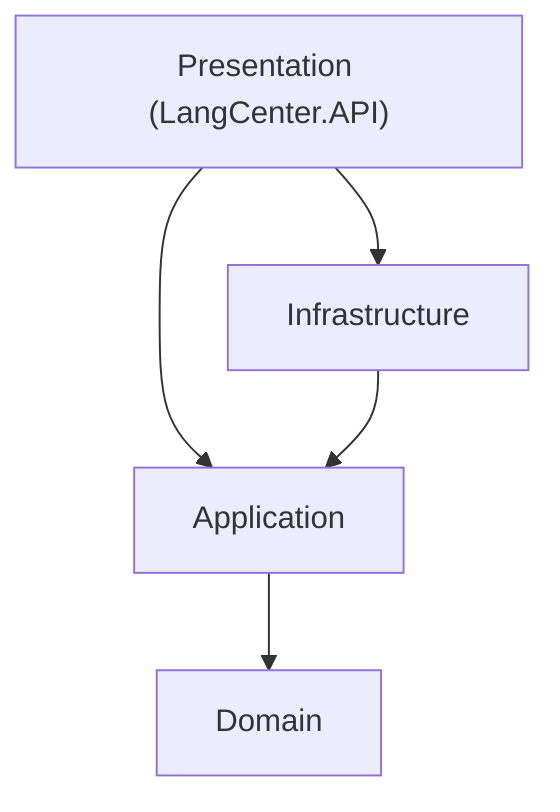
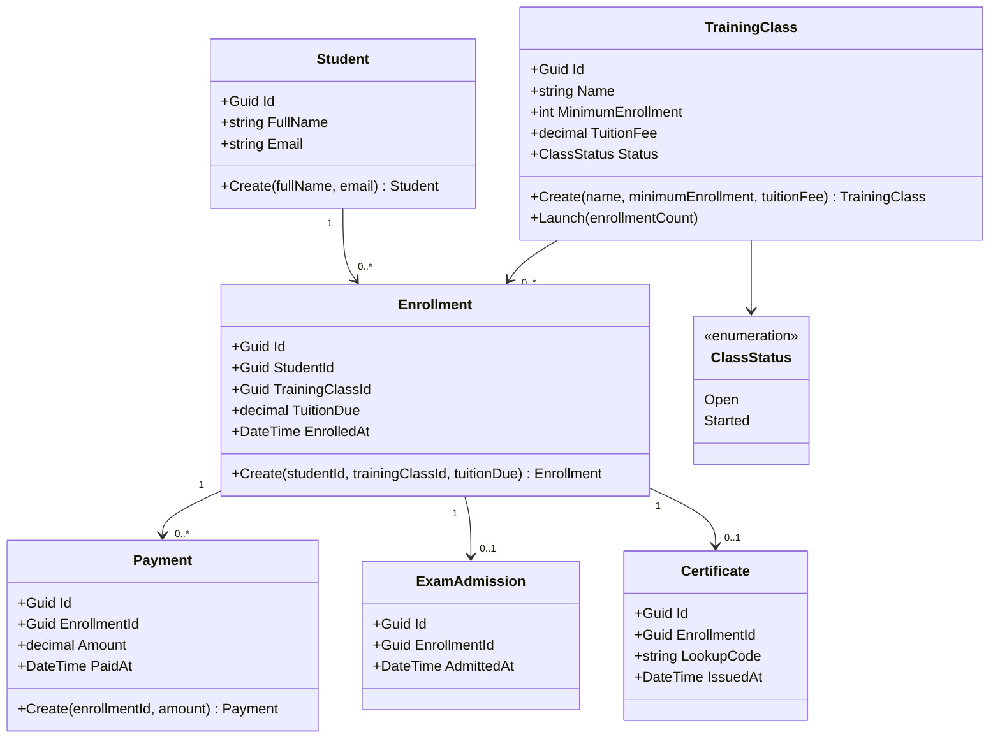

# Thiết kế LangCenter

## Kiến trúc bốn tầng

| Tầng | Project | Trách nhiệm |
| --- | --- | --- |
| Domain | `LangCenter.Domain` | Thực thể, trạng thái, hành vi nghiệp vụ và hợp đồng repository sát Domain |
| Application | `LangCenter.Application` | Command, query, handler, DTO và điều phối quy tắc cần đọc hoặc ghi dữ liệu |
| Infrastructure | `LangCenter.Infrastructure` | EF Core, PostgreSQL, hiện thực repository và dịch vụ kỹ thuật |
| Presentation | `LangCenter.API` | Controllers, yêu cầu HTTP, phân quyền, Swagger, cấu hình DI và phản hồi lỗi |

`LangCenter.Tests` kiểm thử các tầng và gọi API qua host kiểm thử. Các mũi tên dưới đây biểu diễn chiều tham chiếu project.

## Mô hình lớp Domain

`TrainingClass.Launch(enrollmentCount)` kiểm tra trạng thái và ngưỡng sĩ số. Handler của Application lấy số ghi danh từ repository và điều phối việc lưu trạng thái. Tương tự, handler dự thi lấy tổng học phí đã thu trước khi áp dụng QT05.

## Quy ước từ sáu solution tham khảo

| Bài mẫu | Quy ước dùng cho LangCenter |
| --- | --- |
| C1 | Entity có thuộc tính `private set`, factory method `Create(...)` và phương thức thay đổi trạng thái rõ nghĩa. |
| C2 | Tiêm phụ thuộc qua constructor. Đặt tên test theo `Behavior_Condition_ExpectedResult`, ví dụ `Launch_BelowMinimumEnrollment_RejectsLaunch`. |
| C3 | Tổ chức Application theo tính năng. Đặt tên dạng `CreateClassCommand`, `CreateClassCommandHandler` và `HandleAsync`. Controller nhận request, gọi handler và trả kết quả HTTP. |
| C4 | Đặt ánh xạ EF Core trong Infrastructure, ràng buộc tính duy nhất ở cơ sở dữ liệu và chuyển lỗi tập trung thành `ProblemDetails`. |
| C5 | Tổ chức đăng nhập JWT và policy phân quyền theo vai trò trong API. |
| C6 | Dùng .NET 10, một project test xUnit, `WebApplicationFactory` cho API, Docker Compose và CI. |

Các tên lớp, phương thức, biến và ca kiểm thử viết bằng tiếng Anh. Các thao tác bất đồng bộ có hậu tố `Async` và chuyển tiếp `CancellationToken` tới tầng truy cập dữ liệu. Domain giữ quy tắc của từng thực thể. Application giữ quy tắc phối hợp giữa các thực thể. Repository và constructor injection giúp kiểm thử handler bằng phụ thuộc thay thế.

Bài C2 dùng Strategy cho nhiều định dạng báo cáo và Factory để chọn kênh thông báo. Phạm vi hiện tại có một cách tính công nợ và một luồng cấp chứng chỉ. Nhóm bổ sung mẫu thiết kế khi có các biến thể cần biểu diễn.
